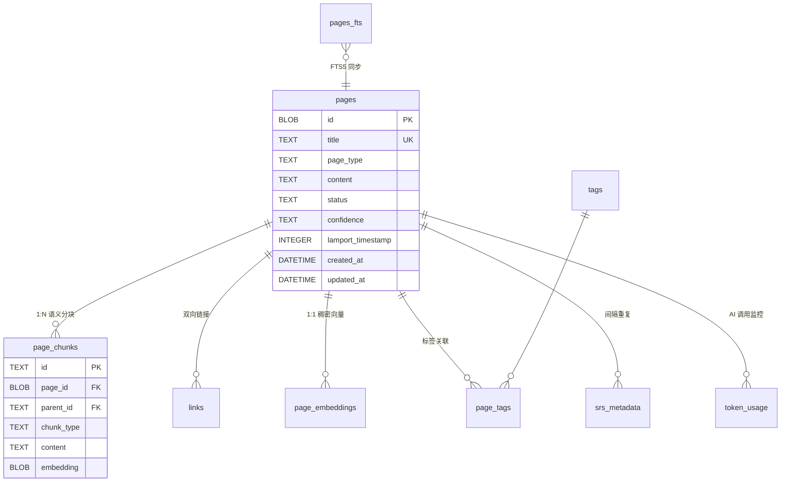

# 智宇 (ZhiYu) 数据库 Schema 设计

本文件记录了智宇 (ZhiYu) 核心数据库的结构设计。系统基于 SQLite 存储，使用 GRDB.swift 与 UFPStorage 进行对象映射与版本管理。

> **Schema 权威来源**：专属笔记本库的核心表结构 DDL 以 `Sources/Infrastructure/Storage/Persistence/init_schema.sql` 为唯一权威（本文档为说明性引用，若与 SQL 冲突以 SQL 为准）。版本化迁移由 `Packages/UFPStorage`（`GenericSchemaMigrator` / `GenericDatabaseManager`）统一管理。

## 0. ER 关系总览



---

## 1. 核心表结构

### 1.1 `pages` (知识页面表)
存储所有知识条目的元数据与核心内容。

| 字段 | 类型 | 约束 | 说明 |
| :--- | :--- | :--- | :--- |
| `id` | BLOB | PRIMARY KEY | 页面唯一标识 (UUID 字节序) |
| `title` | TEXT | NOT NULL, UNIQUE | 页面标题，FTS5 全文索引键 |
| `page_type` | TEXT | NOT NULL | 页面类型 (`concept` / `entity` / `source` / `comparison` / `raw`) |
| `content` | TEXT | NOT NULL | Markdown 原始内容，经插件 preProcess 后入库 |
| `aliases` | TEXT | | 别名列表（逗号分隔），用于搜索联想与 `[[链接]]` 解析 |
| `tags` | TEXT | | 标签列表（逗号分隔，非规范化的冗余存储） |
| `status` | TEXT | NOT NULL DEFAULT `'active'` | 页面状态 (`active` / `stub` / `needsUpdate` / `deprecated`) |
| `confidence` | TEXT | NOT NULL DEFAULT `'medium'` | 可信度 (`high` / `medium` / `low`) |
| `sources` | TEXT | | 引用来源 ID 列表（逗号分隔） |
| `related_page_ids` | TEXT | | 双向链接关联页面 ID（逗号分隔，冗余存储） |
| `is_pinned` | BOOLEAN | NOT NULL DEFAULT 0 | 是否置顶 |
| `content_hash` | TEXT | | 内容 SHA256 哈希，用于增量同步与去重 |
| `custom_icon` | TEXT | | 用户自定义 SF Symbol 图标 |
| `source_url` | TEXT | | 原始资料链接（网页/YouTube），支持溯源 |
| `raw_snippet` | TEXT | | 原始资料片段，用于校验 |
| `file_size` | INTEGER | | 物理字节大小 |
| `source_type` | TEXT | | 来源类型 (`markdown` / `pdf` / `voice` / `ocr`) |
| `lamport_timestamp` | INTEGER | NOT NULL DEFAULT 0 | 逻辑时钟，用于分布式冲突解决 |
| `created_at` | DATETIME | NOT NULL DEFAULT CURRENT_TIMESTAMP | 创建时间 |
| `updated_at` | DATETIME | NOT NULL DEFAULT CURRENT_TIMESTAMP | 最后更新时间（触发器维护） |

> `idx_pages_page_type` 索引建在 `page_type` 上。

### 1.2 `page_chunks` (RAG 语义分块表)
支持高级 RAG（层级分块、问答对、摘要）的核心存储。

| 字段 | 类型 | 约束 | 说明 |
| :--- | :--- | :--- | :--- |
| `id` | TEXT | PRIMARY KEY | 分块 ID (格式: `p_{uuid}_{index}`) |
| `page_id` | BLOB | NOT NULL, FK → pages(id) ON DELETE CASCADE | 所属页面 ID |
| `parent_id` | TEXT | FK → page_chunks(id) ON DELETE CASCADE | 父块 ID，支持 Small-to-Big 层级 |
| `chunk_type` | TEXT | NOT NULL | 类型: `regular` / `summary` / `qa_pair` |
| `content` | TEXT | NOT NULL | 分块文本内容 |
| `anchor_path` | TEXT | | 原文档中的锚点路径 |
| `chunk_index` | INTEGER | NOT NULL | 分块在原文档中的序号 |
| `embedding` | BLOB | | 分块级向量数据 |
| `start_index` | INTEGER | | 在原文档中的字符偏移位置 |
| `created_at` | DATETIME | NOT NULL DEFAULT CURRENT_TIMESTAMP | 创建时间 |
| `updated_at` | DATETIME | NOT NULL DEFAULT CURRENT_TIMESTAMP | 更新时间 |

### 1.3 `links` (知识图谱双向链接表)
知识图谱的边存储，双向链接。

| 字段 | 类型 | 约束 | 说明 |
| :--- | :--- | :--- | :--- |
| `source_id` | BLOB | PRIMARY KEY, FK → pages(id) ON DELETE CASCADE | 源页面 ID |
| `target_id` | BLOB | PRIMARY KEY, FK → pages(id) ON DELETE CASCADE | 目标页面 ID |
| `context` | TEXT | | 链接上下文描述 |
| `created_at` | DATETIME | NOT NULL DEFAULT CURRENT_TIMESTAMP | 创建时间 |

> `idx_links_target_id` 索引建在 `target_id` 上（支持反向遍历）。

### 1.4 `page_embeddings` (页面级高维稠密向量表)

| 字段 | 类型 | 约束 | 说明 |
| :--- | :--- | :--- | :--- |
| `id` | BLOB | PRIMARY KEY, FK → pages(id) ON DELETE CASCADE | 与页面 1:1 |
| `vector_blob` | BLOB | NOT NULL | 页面级向量 |
| `model_name` | TEXT | NOT NULL | 生成向量的模型名 |
| `created_at` | DATETIME | NOT NULL DEFAULT CURRENT_TIMESTAMP | 创建时间 |
| `updated_at` | DATETIME | NOT NULL DEFAULT CURRENT_TIMESTAMP | 更新时间 |

### 1.5 `tags` (范式化标签字典) 与 `page_tags` (页面-标签关联)

`tags`：

| 字段 | 类型 | 约束 | 说明 |
| :--- | :--- | :--- | :--- |
| `id` | TEXT | PRIMARY KEY | 标签 ID |
| `name` | TEXT | NOT NULL, UNIQUE | 标签名 |
| `created_at` | DATETIME | NOT NULL DEFAULT CURRENT_TIMESTAMP | 创建时间 |

`page_tags`：

| 字段 | 类型 | 约束 | 说明 |
| :--- | :--- | :--- | :--- |
| `page_id` | BLOB | PRIMARY KEY, FK → pages(id) ON DELETE CASCADE | 页面 ID |
| `tag_id` | TEXT | PRIMARY KEY, FK → tags(id) ON DELETE CASCADE | 标签 ID |

### 1.6 `srs_metadata` (间隔重复记忆调度表)

| 字段 | 类型 | 约束 | 说明 |
| :--- | :--- | :--- | :--- |
| `page_id` | BLOB | PRIMARY KEY, FK → pages(id) ON DELETE CASCADE | 页面 ID |
| `ease_factor` | REAL | NOT NULL DEFAULT 2.50 | 难度因子 |
| `repetitions` | INTEGER | NOT NULL DEFAULT 0 | 复习次数 |
| `review_interval` | INTEGER | NOT NULL DEFAULT 0 | 复习间隔（天） |
| `next_review_at` | DATETIME | NOT NULL | 下次复习时间 |
| `created_at` | DATETIME | NOT NULL DEFAULT CURRENT_TIMESTAMP | 创建时间 |
| `updated_at` | DATETIME | NOT NULL DEFAULT CURRENT_TIMESTAMP | 更新时间 |

> `idx_srs_next_review` 索引建在 `next_review_at` 上。

### 1.7 `token_usage` / `llm_call_logs` / `rag_evaluations` (AI 资源开销与治理)

`token_usage`：

| 字段 | 类型 | 说明 |
| :--- | :--- | :--- |
| `id` | INTEGER PK AUTOINCREMENT | 记录 ID |
| `model` | TEXT NOT NULL | 使用的模型 ID |
| `prompt_tokens` | INTEGER NOT NULL | 输入 Token |
| `completion_tokens` | INTEGER NOT NULL | 输出 Token |
| `total_tokens` | INTEGER NOT NULL | 总消耗 |
| `created_at` | DATETIME NOT NULL | 产生时间 |

`llm_call_logs`：

| 字段 | 类型 | 说明 |
| :--- | :--- | :--- |
| `id` | INTEGER PK AUTOINCREMENT | 记录 ID |
| `model` | TEXT NOT NULL | 使用的模型 ID |
| `prompt_tokens` | INTEGER NOT NULL | 输入 Token |
| `completion_tokens` | INTEGER NOT NULL | 输出 Token |
| `latency_ms` | INTEGER NOT NULL | 请求耗时 (毫秒) |
| `status` | TEXT NOT NULL | success / failure |
| `created_at` | DATETIME NOT NULL | 产生时间 |

`rag_evaluations`：

| 字段 | 类型 | 说明 |
| :--- | :--- | :--- |
| `id` | INTEGER PK AUTOINCREMENT | 记录 ID |
| `query` | TEXT NOT NULL | 用户提问 |
| `answer` | TEXT NOT NULL | AI 回答内容 |
| `faithfulness_score` | REAL NOT NULL | 忠实度评分 (0-1) |
| `relevance_score` | REAL NOT NULL | 相关性评分 (0-1) |
| `context_precision` | REAL NOT NULL | 上下文精准度 (0-1) |
| `evaluator_model` | TEXT NOT NULL | 执行评估的大模型名称 |
| `created_at` | DATETIME NOT NULL | 评估时间 |

---

## 2. 全文检索 (FTS5)

系统创建了 `pages_fts` 虚拟表，以 `pages` 表为 external content，并通过触发器保持同步：

```sql
CREATE VIRTUAL TABLE IF NOT EXISTS pages_fts USING fts5(
    id UNINDEXED, title, content, tags, aliases,
    content='pages'
);
```

- `id` 标记为 `UNINDEXED`（仅作行关联），`tags`/`aliases` 纳入全文索引以支持别名与标签搜索。
- 联动触发器：`pages_ai`（INSERT）、`pages_ad`（DELETE）、`pages_au`（UPDATE）在 `pages` 表写入时同步维护 `pages_fts` 索引。
- `pages` 表自身通过 `trigger_update_pages_timestamp` 在 UPDATE 时自动刷新 `updated_at`。

---

## 3. 迁移机制说明

核心表结构由 `Sources/Infrastructure/Storage/Persistence/init_schema.sql` 提供最终 DDL；版本化迁移由 `Sources/Infrastructure/Storage/Persistence/DatabaseSchemaMigrator.swift` 渐进执行。

**专属笔记本库迁移历史**（`DatabaseSchemaMigrator`）：

| 版本 | 标识 |
|------|------|
| V1 | `v1_initial_schema` |
| V2 | `v2_fts_initial` |
| V3 | `v3_tag_normalization` |
| V4 | `v4_srs_metadata` |
| V5 | `v5_rag_hallucination_citation` |
| V6 | `v6_retrieval_quality` |
| V7 | `v7_import_records` |
| V8 | `v8_import_record_tags` |
| V9 | `v9_feedback_entries` |
| V10 | `v10_rag_answer_correctness` |
| V11 | `v11_rag_context_sufficiency` |
| V12 | `v12_rag_user_rating` |
| V13 | `v13_feedback_status` |

> 本文档原始 `V1-V9`（`v1_initial`/`v2_fts`/…）标识符已废弃，以 `DatabaseSchemaMigrator.swift` 的实际迁移标识符为准。

---

## 4. 多笔记本全局库

除专属笔记本库外，系统包含一个多笔记本全局库（承载 `global_vaults` / `global_settings` / `audit_logs` / `plugin_records` 等跨笔记本数据）。其迁移历史为 `v1_global_schema` → `v2_global_page_count`。具体表结构请以 `DatabaseSchemaMigrator.swift` 源码为权威来源，本文档不重复列举。