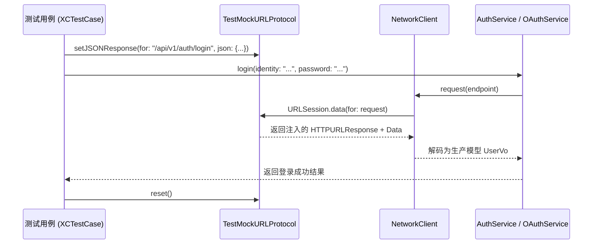

# 智宇 (ZhiYu) 网络层 MockURLProtocol 拦截指南

> **系统层级**：[Tests] 测试架构指南  
> **核心原则**：生产代码面向真实网络契约编程，测试逻辑通过底座标准 `URLProtocol` 进行拦截隔离。严禁在生产服务或数据模型中注入 Mock 分支。

---

## 1. 为什么废止 `isMockBackend` / `forceMockBackend`

在早期的开发中，由于后端环境不稳定，部分认证服务（如 `AuthService`、`OAuthService`）在生产逻辑中内嵌了 `isMockBackend` 开关与 `forceMockBackend` 后门属性。这带来了以下严重架构坏味道与安全风险：

1. **生产环境安全隐患**：若发布构建（Release）因配置错误保留了后门分支，恶意用户可通过修改内存或参数绕过真实后端认证；
2. **测试不真实（假阳性）**：业务代码绕过了真实的网络请求参数组装、HTTP Header 构建与 JSON 序列化/反序列化流程，测试无法发现真实的接口契约漂移；
3. **并发污染与状态泄漏**：静态变量 `forceMockBackend` 跨测试用例共享，并发测试时容易导致状态互相踩踏；
4. **违反单一职责**：业务服务既承担业务逻辑，又承担 Mock 模拟器的职责，代码复杂度激增。

---

## 2. 核心组件：`MockURLProtocol`

工程在 `Tests/Shared/MockURLProtocol.swift` 提供了线程安全的统一拦截器：

```swift
final class TestMockURLProtocol: URLProtocol, @unchecked Sendable {
    // 注入响应处理器
    static func setHandler(for path: String, handler: @escaping (URLRequest) throws -> (HTTPURLResponse, Data))
    
    // 注入静态 JSON 响应
    static func setJSONResponse(for path: String, statusCode: Int, json: [String: Any])
    
    // 清理所有拦截处理器
    static func reset()
}
```

### 拦截原理示意图



---

## 3. 标准编写范式 (AAA 模式)

### 3.1 成功响应模拟 (Happy Path)

```swift
func testLogin_Success() async throws {
    // 1. Arrange: 注入期望的后端标准 JSON 响应
    TestMockURLProtocol.setJSONResponse(
        for: "/api/v1/auth/login",
        statusCode: 200,
        json: [
            "code": 200,
            "message": "success",
            "data": [
                "token": "valid_jwt_token",
                "refreshToken": "valid_refresh_token",
                "user": [
                    "id": "u-123",
                    "nickname": "TestUser"
                ]
            ]
        ]
    )
    defer { TestMockURLProtocol.reset() }

    // 2. Act: 调用业务服务真实 API
    let success = await authService.login(identity: "13800000000", password: "Password123!")

    // 3. Assert: 验证全流程业务状态
    XCTAssertTrue(success)
    XCTAssertTrue(authService.isAuthenticated)
    XCTAssertEqual(authService.currentUser?.id, "u-123")
}
```

### 3.2 错误与异常路径模拟 (Error Path)

```swift
func testLogin_InvalidPassword_ThrowsError() async throws {
    // 1. Arrange: 模拟后端返回 401 业务错误
    TestMockURLProtocol.setJSONResponse(
        for: "/api/v1/auth/login",
        statusCode: 401,
        json: [
            "code": 401,
            "message": "密码错误"
        ]
    )
    defer { TestMockURLProtocol.reset() }

    // 2. Act & Assert: 验证业务优雅降级或抛出标准 AppError
    let success = await authService.login(identity: "13800000000", password: "WrongPassword")
    XCTAssertFalse(success)
    XCTAssertFalse(authService.isAuthenticated)
}
```

---

## 4. 门禁规则与 CI 卡控

工程已在 CI 流水线与 `make audit` 中集成了如下两项强阻断守卫：

1. **`check-code-test-coupling.py --strict`**：
   - 严禁在 `Sources/` 中出现 `isMockBackend`、`isMockMode`
   - 严禁在 `Sources/` 中出现 `mock_` 凭据字面量
   - 严禁在 `Sources/` 生产类中暴露测试专用后门 API（`*ForTesting`）
2. **`audit-debug-in-sources.py --strict`**：
   - 严禁在 `Sources/` 中通过 `#if DEBUG` 嵌入业务分叉或 Mock 数据
